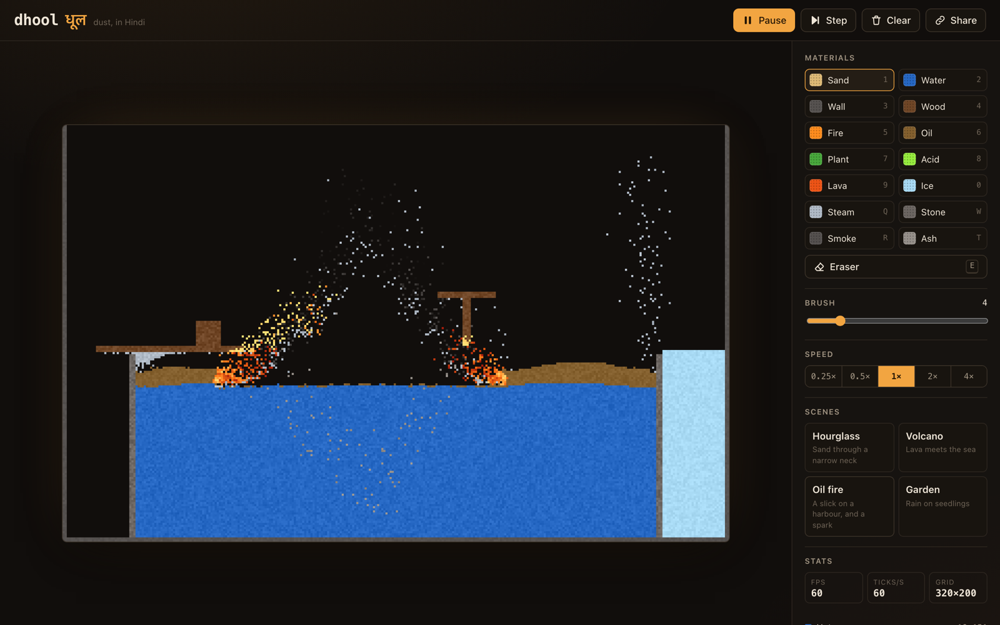
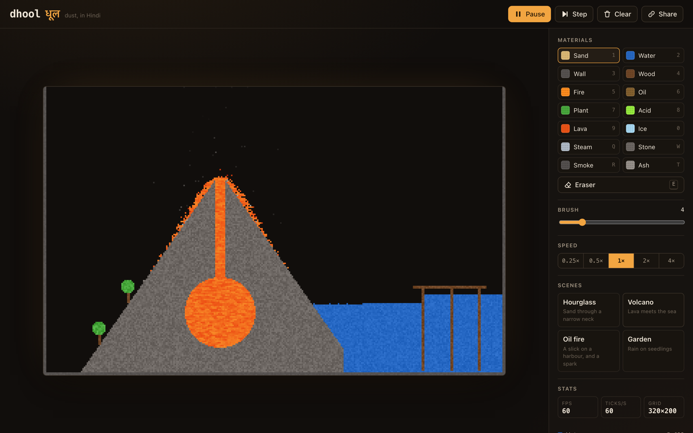
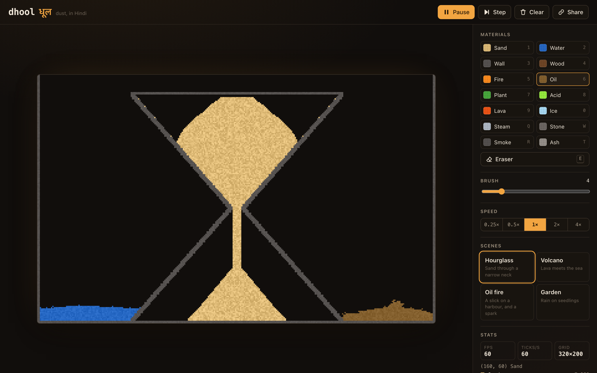
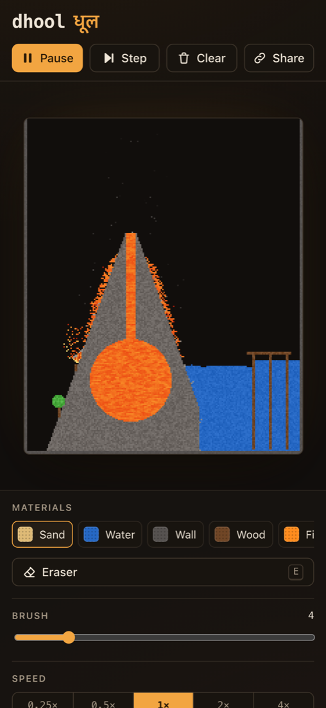

# dhool (धूल)

*Dhool* is Hindi for "dust". It is a falling-sand sandbox: you pour sand, water, oil, fire, acid and lava onto a grid and watch them interact. The simulation is a cellular automaton written in Rust and compiled to a 36 KB WebAssembly module with no dependencies. A small TypeScript front end draws it and handles input.

[](https://samarthjaiswal.github.io/dhool/)
[](https://github.com/SAMARTHJAISWAL/dhool/actions/workflows/ci.yml)
[](LICENSE)

**Try it: https://samarthjaiswal.github.io/dhool/**



| Volcano | Hourglass | Phone |
| --- | --- | --- |
|  |  |  |

## What it is

The world is a grid of 320 × 200 cells (200 × 240 on a portrait phone). Every cell holds one material. Sixty times a second, each cell looks at its neighbours and decides whether to move or react, following a short rule for its material. Large-scale behaviour comes out of those local rules: sand forms 45° piles, water finds its level, oil floats, fire runs along a slick and leaves smoke behind.

The project is meant to show two things: a simulation core in idiomatic Rust that is fast and properly tested, and a clean boundary between that core and the browser without any binding generator.

## Features

- 15 materials (14 you can paint) with documented rules and reactions.
- A brush you can use with a mouse, pen or finger. Strokes are interpolated, so a fast drag still draws a solid line. Right-click or the eraser removes material.
- Four built-in scenes, drawn in code: Hourglass, Volcano, Oil fire and Garden.
- Share links. The scene is run-length encoded in Rust, base64url'd and put in the URL hash. Opening the link restores it.
- Pause, single-step, five speeds (0.25× to 4×), a live FPS and ticks-per-second readout, per-material cell counts, and the material under the cursor.
- A fixed 60 Hz simulation step, independent of the display's refresh rate. The loop stops when the tab is hidden.
- Keyboard shortcuts for everything, focus outlines, ARIA roles on the palette and speed controls, and `prefers-reduced-motion` support: the scene starts paused and UI animations are turned off.
- Deterministic: the same seed and the same inputs always produce the same grid.

## Materials

| Material | Behaviour | Interacts with |
| --- | --- | --- |
| **Empty** | Nothing. | Anything can move into it. |
| **Wall** | Static and indestructible. | Nothing affects it, acid included. |
| **Sand** | Falls, then slides down a random diagonal, which gives 45° piles. Density 90. | Sinks through any liquid by swapping with it (with drag, so it drifts down). Acid eats it. |
| **Water** | Falls, slides diagonally, then flows up to 5 cells sideways per tick. Density 50. | Boils to steam when it touches fire or lava. Plants grow into it, ice freezes it. Oil floats on it. |
| **Oil** | Liquid, spreads 4 cells per tick. Density 40, so it floats on water. | Very flammable (48/256 chance per tick per touching flame). Burns quickly. |
| **Fire** | Lives 20–50 ticks, drifts upward and flickers. Only moves into empty space and can't be displaced. | Ignites flammable neighbours, melts ice. Touching water turns that water to steam and puts the fire out. Burns out to smoke (40%), ash (10%) or nothing. |
| **Steam** | Gas: rises with a random sideways wobble. Lighter than every liquid, so it bubbles up through them. | Condenses back into exactly one water cell when its lifetime runs out (about 3–7 s at normal speed). |
| **Wood** | Static. | Flammable (24/256); its flames last 60–140 ticks. Acid eats it. |
| **Plant** | Static. | Grows into neighbouring water, one cell for one cell. Flammable (32/256). Acid eats it. |
| **Acid** | Liquid, density 60, so it sinks under water. Spreads 3 cells per tick. | Dissolves sand, stone, wood, plant, ice and ash. One acid cell destroys one cell and is used up, sometimes leaving a wisp of smoke. It can't touch wall. |
| **Smoke** | Gas: rises and fades into the background as it ages. | Disappears after 40–120 ticks. |
| **Lava** | Very slow liquid: moves on only a quarter of ticks and spreads 1 cell. Density 80. Its glow shimmers. | Turns to stone and boils the water when it touches water. Ignites flammables, melts ice, throws an occasional spark. |
| **Stone** | Static. What quenched lava becomes. | Acid eats it. |
| **Ice** | Static. | Slowly freezes neighbouring water. Melts back to water next to fire or lava. |
| **Ash** | Light powder (density 70) left by fire. | Sinks in water, floats on lava. Acid eats it. |

All of these numbers live in one table in [`sim/src/material.rs`](sim/src/material.rs), and the rules read them from there.

## Controls

| Action | Mouse / touch | Key |
| --- | --- | --- |
| Paint | Drag on the canvas (hold still to keep pouring) | |
| Erase | Right-drag, or the Eraser button | `E` toggles the eraser |
| Choose a material | Palette | `1`–`9`, `0` (Sand, Water, Wall, Wood, Fire, Oil, Plant, Acid, Lava, Ice), `Q` Steam, `W` Stone, `R` Smoke, `T` Ash |
| Brush size (0–24) | Slider | `[` and `]` |
| Pause / play | Pause button | `Space` |
| Step one tick | Step button | `.` |
| Speed | 0.25× … 4× buttons | |
| Load a scene | Scenes panel | |
| Share | Share button (copies the link) | |
| Clear | Clear button | |

Within the palette, the arrow keys move between materials.

## How it works

### Grid and update order

`World` holds a `Vec<Cell>` in row-major order. A `Cell` is four bytes: material, remaining lifetime (for fire, steam and smoke), a random shade byte for texture, and a one-byte clock.

Each tick increments the world clock and visits every cell once, **bottom row first**. A grain that falls lands in a row that has already been processed, so it can't be processed again in the same pass. Rising gases and sideways flows can still move into rows or columns that haven't been visited yet. To handle that, every cell that acts, and every cell it swaps with, gets stamped with the current clock, and stamped cells are skipped for the rest of the tick. Newly created cells (a flame catching, steam condensing) get the same stamp. So nothing moves or reacts more than once per tick, without needing a second buffer.

The **horizontal scan direction alternates** every tick. If it always ran left to right, a liquid's sideways moves would favour one direction and piles would lean. The `piles_do_not_lean_to_one_side` test checks that a pile poured in the middle stays balanced within 10%.

### Density displacement

All movement goes through one function, `can_displace(mover, target, direction)` in [`sim/src/rules.rs`](sim/src/rules.rs):

- anything can move into empty space;
- solids, powders and fire are never displaced;
- moving **down**, the mover must be denser than the liquid or gas below;
- moving **up**, the mover must be lighter (that is how steam bubbles up through water);
- moving **sideways**, only a liquid can push a lighter fluid aside.

That one rule gives you sand sinking through water, water sliding under oil, steam rising through a lake and acid settling under water, with no special case for any pair of materials. A move is a swap, so mass is conserved by construction. The tests check this: sand, water, oil and wall counts stay identical over 1,000 ticks in a closed box, and steam plus water stays constant while steam condenses.

### PRNG

Each world owns a seeded xorshift32 generator ([`sim/src/rng.rs`](sim/src/rng.rs)): three shifts and three xors per number, with all its state in one `u32`, which is native on wasm32. The seed is first scrambled with a SplitMix-style finaliser so that small seeds such as 1, 2 and 3 don't start out correlated, and so that a zero seed can't lock the generator at zero. `below(n)` uses multiply-shift instead of `%`. Every random decision in the simulation (which diagonal to try, whether fire spreads this tick) comes from this generator, so a given seed always produces the same grid. Rendering hashes the cell index and tick count instead of drawing from the generator, so drawing a frame or skipping it can't change the simulation. Both properties are tested.

### Zero-copy pixels between WASM and JS

`World::render` writes one `u32` per cell into a `Vec<u32>`, packed as `0xAABBGGRR`. Read as little-endian bytes, that is R, G, B, A, which is exactly the layout `ImageData` uses. The FFI exports `pixels_ptr()`, and the front end wraps that address in a typed array view over WebAssembly memory:

```ts
const view = new Uint8ClampedArray(memory.buffer, ptr, width * height * 4);
const image = new ImageData(view, width, height);
ctx.putImageData(image, 0, 0);
```

No pixel data is copied between Rust and JavaScript. The only copy is `putImageData` uploading the frame to the canvas. The view is rebuilt only when the memory grows (which detaches the old `ArrayBuffer`) or the grid is re-created. The canvas is the grid's native size and is scaled up with CSS `image-rendering: pixelated`, so each cell is a crisp square.

Save files cross the boundary the same way. `save()` encodes into a scratch buffer and returns its length, and JS reads it from `io_ptr()`. For `load`, JS calls `io_reserve(len)`, writes the bytes at the returned pointer, then calls `load(len)`.

### Why there is no wasm-bindgen

The interface is about twenty functions that take and return integers. For that, wasm-bindgen and wasm-pack would add a second toolchain, a generated JS glue file and a build step, and would save very little. Without them, the whole build is:

```sh
cargo build --release --target wasm32-unknown-unknown
```

The module needs no imports, so it is instantiated with an empty import object: `WebAssembly.instantiateStreaming(fetch(url), {})`. The export surface is in [`sim/src/ffi.rs`](sim/src/ffi.rs) (around 200 lines, most of them doc comments), and its typed JS counterpart is in [`web/src/wasm.ts`](web/src/wasm.ts). The FFI keeps one global `World` in an `UnsafeCell`. That is sound because wasm32 without the threads proposal runs on a single thread, and the exports never call back into JS. The `SAFETY` comments explain this. The module is compiled only for `wasm32`. Everything else is plain Rust that builds and is tested on the host.

### Snapshot format

Share links use a run-length encoding ([`sim/src/rle.rs`](sim/src/rle.rs)): the magic bytes `DHL`, a version byte, the width and height as `u16`, then a sequence of runs, each a material id byte plus `run length − 1` as a LEB128 varint. Runs continue across row ends, so an empty sky is one run. An empty 320 × 200 grid encodes to 12 bytes. A busy scene is 1–4 KB, which becomes a 2–5 KB link. The decoder rejects bad magic bytes, unknown versions, dimensions over 1024, unknown material ids, truncated varints and runs that don't add up to exactly width × height. It can't be made to panic or to allocate more than the size cap.

## Performance

Measured on an Apple M3 (macOS), with a busy 320 × 200 scene: sand, a water tank, an oil slick, burning wood and a lava pool, about 40% of cells non-empty.

| | Native (`cargo run --release --example bench`) | WebAssembly in headless Chromium |
| --- | --- | --- |
| Simulation tick | 0.17 ms (~5,800 ticks/s) | 0.22 ms (~4,600 ticks/s) |
| Render to pixel buffer | 0.14 ms (~7,300 frames/s) | 0.16 ms (~6,400 frames/s) |

At the normal 60 ticks/s, the simulation uses about 1.3% of one core in the browser. Even at 4× speed, each frame's simulation work is under 1 ms. WebAssembly runs at about 80% of native speed here.

| Artifact | Size | Gzipped |
| --- | --- | --- |
| `dhool.wasm` | 36.1 KB | 14.0 KB |
| JS bundle | 15.5 KB | 6.2 KB |
| CSS | 7.8 KB | 2.6 KB |

The release profile uses `opt-level = 3`, `lto = true`, `codegen-units = 1`, `panic = "abort"` and `strip = true`. With `opt-level = "s"` the module is 32.7 KB. I kept level 3 because the 3 KB saved isn't worth the slower ticks. Most of the module is the standard library's allocator.

## Project structure

```
dhool/
├── Cargo.toml              workspace and release profile
├── sim/                    the Rust crate (dhool-sim)
│   ├── src/
│   │   ├── lib.rs          public API
│   │   ├── material.rs     material enum and property tables
│   │   ├── rules.rs        per-material update rules, can_displace
│   │   ├── world.rs        grid, painting, tick loop, rendering
│   │   ├── color.rs        per-cell colour, grain, shimmer
│   │   ├── rle.rs          run-length save/load
│   │   ├── rng.rs          xorshift32
│   │   └── ffi.rs          extern "C" exports (wasm32 only)
│   ├── tests/              behaviour and snapshot tests
│   └── examples/bench.rs   throughput benchmark
├── web/                    the front end (Vite root)
│   ├── index.html
│   ├── public/             favicon.svg, og.png
│   └── src/
│       ├── main.ts         UI, input, main loop
│       ├── wasm.ts         typed wrapper over the exports
│       ├── materials.ts    palette config (ids mirror the Rust enum)
│       ├── presets.ts      built-in scenes
│       ├── stroke.ts       stroke interpolation
│       ├── share.ts        base64url and URL hash
│       ├── loop.ts         fixed-step accumulator, rate meter
│       ├── style.css
│       └── *.test.ts       Vitest suites
├── scripts/build-wasm.mjs  cargo build + copy the .wasm for Vite
├── docs/                   screenshots
└── .github/workflows/      ci.yml, deploy.yml
```

## Building and running locally

You need Rust (stable, edition 2024, 1.85 or newer) with the wasm target, and Node 22 or newer.

```sh
rustup target add wasm32-unknown-unknown   # rust-toolchain.toml also asks for it
npm ci
npm run dev        # builds the wasm, then starts Vite on http://localhost:5173
```

Other commands:

```sh
cargo test                                            # Rust tests
cargo clippy --all-targets -- -D warnings             # host lints
cargo clippy --target wasm32-unknown-unknown -- -D warnings
cargo fmt --check
cargo run --release --example bench -p dhool-sim      # timing numbers

npm run wasm        # just the cargo build + copy into web/src/wasm/
npm run typecheck   # tsc --noEmit (strict)
npm test            # Vitest
npm run build       # wasm + typecheck + production build into dist/
GITHUB_PAGES=true npm run build   # same, with base path /dhool/
```

`npm run wasm` runs `cargo build --release --target wasm32-unknown-unknown -p dhool-sim` and copies `target/wasm32-unknown-unknown/release/dhool_sim.wasm` to `web/src/wasm/dhool.wasm`. Vite then imports it as a hashed asset URL.

## Tests

**Rust: 76 tests** (`cargo test`). 32 are unit tests inside the modules, 31 are behaviour tests in [`sim/tests/behaviour.rs`](sim/tests/behaviour.rs), 12 are snapshot tests in [`sim/tests/snapshot.rs`](sim/tests/snapshot.rs), and 1 is a doctest. The behaviour tests each set up a small scene and check something you could see on screen:

- sand falls one cell per tick and piles into a slope with no step steeper than one cell; piles don't lean;
- water levels out to within one cell; oil ends up on top of water even when it starts underneath; sand sinks to the bottom of a tank; steam bubbles up through water; lava spreads less than half as far as water;
- mass conservation in a closed box over 1,000 ticks, and steam condensing back into the same number of water cells;
- fire burns a wood block away completely, producing smoke and leaving only ash or nothing; fire burns out on its own; oil burns; water puts fire out and becomes steam;
- acid dissolves sand one-for-one with its own loss, eats stone, wood, ice and plant, and leaves wall alone; wall survives lava, acid and fire;
- lava plus water gives stone and steam; lava ignites wood; plants grow into water but not air; ice freezes water and melts near fire; smoke rises and fades;
- the same seed gives identical cells and pixels, different seeds diverge, and rendering doesn't change the simulation;
- painting and filling off the edge of the grid, with extreme coordinates or huge radii, is safe;
- snapshots round-trip, are compact, and reject every kind of malformed input.

**TypeScript: 30 tests** (`npm test`) for stroke interpolation (no gaps, spacing, end points), base64url and URL hash encoding and decoding, the fixed-step loop, the presets (they build sensible scenes at both grid sizes), and the palette config. The palette test parses the `Material` enum out of the Rust source, so the TS ids and the Rust ids can't drift apart.

CI runs all of this, plus clippy for the wasm target and both production builds. Deployment builds with `GITHUB_PAGES=true` and publishes `dist/` with `actions/deploy-pages`.

## Licence

MIT © 2026 Samarth Jaiswal. See [LICENSE](LICENSE).
